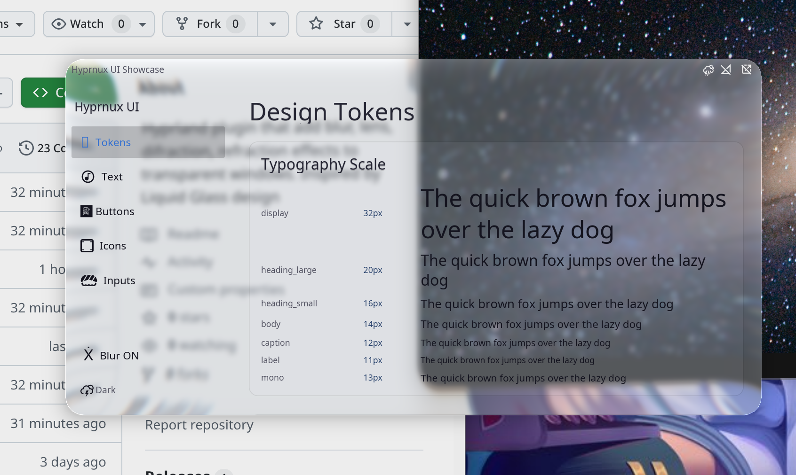

# HyprGlass - Liquid Glass inspired plugin for Hyprland

Liquid Glass for [Hyprland](https://hyprland.org/).

Frosted blur, edge refraction, chromatic aberration, specular highlights — fully customizable, per-theme, on every window and layer surface.

| Dark | Light |
|:---:|:---:|
|  |  |

## Installation

### hyprpm (recommended)

Builds against your exact Hyprland version, no ABI mismatch headaches:

```bash
hyprpm add https://github.com/hyprnux/hyprglass
hyprpm enable hyprglass
```

On a Hyprland release, hyprpm installs the hyprglass release made for it. On hyprland-git, it builds `main`, which follows Hyprland's development branch.

### Pre-built release

Grab `hyprglass.so` from [Releases](https://github.com/hyprnux/hyprglass/releases/latest). Each release targets a specific Hyprland API version — check the release notes to confirm it matches yours. If it doesn't match, hyprglass stays paused instead of crashing Hyprland (see [Troubleshooting](#troubleshooting)).

```bash
hyprctl plugin load /path/to/hyprglass.so
```

Or persist it in your config:

```lua
hl.plugin.load("/path/to/hyprglass.so")
```

### Manual build

```bash
git clone https://github.com/hyprnux/hyprglass && cd hyprglass
git checkout hyprland-0.57   # branch of your Hyprland version; stay on main for hyprland-git
make
hyprctl plugin load $(pwd)/hyprglass.so
```

## Configuration

### Config

The plugin must be loaded before configuring it. Wrap everything in a guard:

```lua
if hl.plugin.hyprglass then
    local hg = hl.plugin.hyprglass

    hg.config({
        default_theme = "dark",
        default_preset = "clear",
        tint_color = 0x8899aa22,

        brightness = 0.9,
        dark = { brightness = 0.82 },
        light = { adaptive_boost = 0.5 },

        layers = { enabled = true },
    })

    -- Layer surfaces: each call whitelists the namespace and configures it
    hg.layer("waybar", { preset = "subtle", mask_threshold = 0.05 })
    hg.layer("swaync")
    hg.layer("quickshell:bezel", { preset = "ui", mask_threshold = 0.3 })
    hg.layer("debug-panel", { exclude = true })

    -- Presets
    hg.preset("clear", {
        glass_opacity = 0.8,
        blur_strength = 1.5,
        dark = { brightness = 0.7 },
        light = { brightness = 1.2 },
    })

    hg.preset("contrasted", {
        inherits = "high_contrast",
        contrast = 1.2,
        adaptive_dim = 1.5,
        dark = { tint_color = 0x02142aa9 },
    })
end
```

**Checking the config**

```sh
hyprctl configerrors                                # unknown options and wrong values in hg.config, hg.preset and hg.layer
hyprctl getoption plugin:hyprglass:layers:enabled   # "set: true" once your value is applied
```

### Global settings

| Option | Type | Default | Description |
|---|---|---|---|
| `enabled` | bool | `true` | Enable/disable the effect globally. Per-window tags override this. |
| `manage_window_blur` | bool | `true` | Automatically set the `no_blur` property on glassed windows. Glass replaces Hyprland's blur; without `no_blur`, Hyprland's cached-blur optimization (`decoration.blur.new_optimizations`) hides the glass on static windows. Set to `false` to set the `no_blur` window rule yourself (`hl.window_rule({ match = { class = "kitty" }, no_blur = true })`). |
| `skip_opaque_windows` | bool | `true` | Skip glass under an opaque window — it would be invisible anyway, so skipping it saves GPU. Set to `false` to force glass everywhere. Windows using `self_sample` are never skipped, since their glass shows their own content. |
| `blur_fold` | bool | `true` | Fewer blur passes with an identical look. Set to `false` to always run `blur_iterations` passes at the configured radius. |
| `default_theme` | string | `dark` | Default theme: `dark` or `light` |
| `default_preset` | string | `default` | Default preset name |

### Overridable settings

Set globally, per theme (`dark = {}` / `light = {}` table), or in a preset.

Settings resolve through: **preset chain** (theme variant, shared, inherited) then **theme override** then **global value** then **hardcoded default**.

| Option | Type | Global Default | Dark Default | Light Default | Description |
|---|---|---|---|---|---|
| `blur_strength` | float | `2.0` | — | — | Blur radius scale (`value * 12.0` px) |
| `blur_iterations` | int | `3` | — | — | Gaussian blur passes (1-5) |
| `noise_strength` | float | `0.0` | — | — | Frosted grain over the glass, see [Frosted grain](#frosted-grain) (0.0-1.0) |
| `refraction_strength` | float | `0.6` | — | — | Edge refraction intensity (0.0-1.0) |
| `refraction_flow` | float | `0.0` | — | — | Where the edge distortion pulls: 0 toward the window center, 1 along the edges (0.0-1.0) |
| `refraction_spread` | float | `1.0` | — | — | How deep the distortion reaches: 1 across the whole window, 0 only a rim with a flat center (0.0-1.0) |
| `chromatic_aberration` | float | `0.5` | — | — | Spectral dispersion at edges (0.0-1.0) |
| `fresnel_strength` | float | `0.6` | — | — | Edge glow intensity (0.0-1.0) |
| `fresnel_tint` | float | `0.0` | — | — | Color of the edge glow: 0 white, 1 the colors behind the glass (0.0-1.0) |
| `fresnel_color` | color | `0xffffff00` | — | — | Color of the edge glow; alpha sets how much it replaces white (0xRRGGBBAA) |
| `specular_strength` | float | `0.8` | — | — | Specular highlight brightness (0.0-1.0) |
| `specular_angle` | float | `0.0` | — | — | Where the specular highlight comes from, in degrees: 0 from the top, 90 from the right, clockwise |
| `bevel_strength` | float | `0.0` | — | — | Thin lit line along the glass edge, a nicer border (0.0-1.0) |
| `bevel_size` | float | `6.0` | — | — | Width of the bevel line in logical pixels, uniform across monitor scales |
| `bevel_color` | color | `0xffffff00` | — | — | Color of the bevel line; alpha sets how much it replaces white, dark colors give a dark line (0xRRGGBBAA) |
| `bevel_tint` | float | `0.0` | — | — | Tint of the bevel line: 0 its own color, 1 the colors behind the glass (0.0-1.0) |
| `bevel_angle` | float | `315.0` | — | — | Where the bevel light comes from, in degrees: 0 from the top, 90 from the right, clockwise |
| `bevel_shadow` | float | `0.0` | — | — | Darkening of the bevel line on the side away from the light (0.0-1.0) |
| `glass_opacity` | float | `1.0` | — | — | Overall glass opacity (0.0-1.0) |
| `edge_thickness` | float | `0.06` | — | — | Bezel width, fraction of smallest dimension (0.0-0.15) |
| `edge_thickness_px` | float | `0.0` | — | — | Bezel width in logical pixels, the same on every window size and monitor scale. Above `0` it replaces `edge_thickness`, see [Edge thickness in pixels](#edge-thickness-in-pixels) |
| `edge_height` | float | `0.0` | — | — | Turns the edge into a lens: a narrow, crisp bend with a flat center. Height of the glass edge in logical pixels, `0` keeps the soft edge, see [Lens edge](#lens-edge) (0-60) |
| `fresnel_reflection` | float | `0.0` | — | — | The lens edge mirrors what is around the glass: 0 none, 1 a mirror. Needs `edge_height` (0.0-1.0) |
| `tint_color` | color | `0x8899aa22` | — | — | Glass tint RRGGBBAA hex. Alpha = tint strength |
| `lens_distortion` | float | `0.5` | — | — | Center dome magnification (0.0-1.0) |
| `self_sample` | float | `0.0` | — | — | Mixes the window's own content into the glass behind it (0.0-1.0). Windows only |
| `xray` | int | `0` | — | — | `1` hides the windows under the glass: only the wallpaper shows through, `0` off. `true` and `false` work too. See [X-ray](#x-ray) |
| `focus_light` | float | `0.0` | — | — | Light along the glass edge of the active window, `0` off. See [Focus light](#focus-light) (0.0-1.0). Windows only |
| `focus_light_color` | color | `0xffffff00` | — | — | Color of the focus light; alpha sets how much it replaces white (0xRRGGBBAA) |
| `frost` | float | `0.0` | — | — | The glass blurs further where other windows are behind it and stays clear over the wallpaper, `0` off. See [Frost](#frost) (0.0-1.0). Windows only |
| `frost_blur` | float | `3.0` | — | — | Extra blur of the frost, in `blur_strength` units on top of it. Needs `frost` (0.5-3, at most 10: past about 3 the blur stops getting wider) |
| `brightness` | float | — | `0.82` | `1.12` | Brightness multiplier |
| `contrast` | float | — | `0.90` | `0.92` | Contrast around midpoint |
| `saturation` | float | — | `0.80` | `0.85` | Desaturation (0 = grayscale, 1 = full) |
| `vibrancy` | float | — | `0.15` | `0.12` | Selective saturation boost |
| `vibrancy_darkness` | float | — | `0.0` | `0.0` | Holds vibrancy back in dark areas: 0 boosts everywhere, 1 leaves black untouched, above 1 desaturates dark areas |
| `adaptive_dim` | float | — | `0.4` | `0.0` | Dims bright areas behind the glass (white is white 0 -to- 1 white becomes black) |
| `adaptive_boost` | float | — | `0.0` | `0.4` | Boosts dark areas behind the glass (black is black 0 -to- 1 black becomes white) |

`—` in Global Default = falls through to per-theme default. `—` in Dark/Light = inherits global value.

Ranges in parentheses are the usual span, not limits: only `blur_iterations`, `self_sample`, `focus_light`, `frost`, `fresnel_reflection`, `edge_thickness_px` (at most half the smaller side) and `edge_height` (at most 500) are clamped, and the built-in presets go past some of them (`glass` uses `refraction_strength = 8.0`).

#### Self sampling

`self_sample` needs a translucent window: its content is composited over the sampled desktop.

- At `1.0` the pane shows the window's own pixels. Where the client draws translucent ones (terminal transparency), the desktop still shows through
- A window made see-through by an `opacity` window rule draws opaque pixels, so its pane is entirely its own content
- Raise `blur_strength` with it, or the window's own text stays readable in its glass
- A window showing the screen (screen-share preview, OBS) sees a one-frame-old copy of itself
- Layer surfaces ignore it

**Cost:** a self-sampling window re-blurs its whole pane whenever its content changes, so busy windows cost more than static ones.

**On the fly:**
```bash
hyprctl eval 'hl.plugin.hyprglass.config({ self_sample = 1.0 })'
```

```lua
hg.config({ self_sample = 0.6 })
hg.preset("aura", { inherits = "glass", self_sample = 1.0, blur_strength = 2.5 })
```

#### X-ray

With `xray = true` the glass shows the wallpaper (and background/bottom layers) and never the windows under it, however light the blur. Same idea as Hyprland's `decoration.blur.xray`. Turn it on everywhere, or only where a preset applies:

**On the fly:**
```bash
hyprctl eval 'hl.plugin.hyprglass.config({ xray = true })'
```

```lua
hg.config({ xray = true })                                   -- every glass
hg.preset("pane", { inherits = "glass", xray = true })       -- or only this preset
hl.window_rule({ match = { class = "foot" }, tag = "+hyprglass_preset_pane" })
hg.layer("waybar", { preset = "pane" })
```

- Background and bottom layers never use it: they already show only what is under them
- No effect with `render.xp_mode`, which draws no wallpaper
- Layer glass samples the live frame while the session is locked
- Glass over a fullscreen window or on a special workspace shows the wallpaper without the fullscreen window or the special workspace dim
- Subsurface item glass ignores it

**Cost:** one monitor-sized framebuffer per monitor showing x-ray glass (twice that with HDR), freed once the monitor has drawn 600 frames with no x-ray glass on it (about 10 s of activity at 60 Hz).

#### Frosted grain

`noise_strength` adds a fine, still grain to the glass so the blur reads as frosted glass: `0` none, `1` strong. `0.12` is about as strong as Hyprland's default `decoration.blur.noise`.

**On the fly:**
```bash
hyprctl eval 'hl.plugin.hyprglass.config({ noise_strength = 0.3 })'
```

```lua
hg.config({ noise_strength = 0.3, light = { noise_strength = 0.15 } })
hg.preset("frosted", { inherits = "subtle", noise_strength = 0.5 })
```

- The built-in `clear` preset turns the grain off, as it does the blur

#### Edge thickness in pixels

`edge_thickness` is a fraction of the window's smaller side, so big windows get a wide edge and small ones a thin edge. `edge_thickness_px` gives every window the same edge width, in logical pixels. `0` (default) keeps `edge_thickness`.

**On the fly:**
```bash
hyprctl eval 'hl.plugin.hyprglass.config({ edge_thickness_px = 12 })'
```

```lua
hg.config({ edge_thickness_px = 12 })
hg.preset("relative", { inherits = "glass", edge_thickness_px = 0 })   -- back to edge_thickness
```

- Applies to windows, layers and subsurface items
- Never wider than half the smaller side of the glass: the window, the layer, or a subsurface item's shape

#### Lens edge

`edge_height` turns the soft edge into a lens, like the rim of a thick glass pane: a narrow, crisp bend with a perfectly flat center. It is the height of the glass at the edge, in logical pixels: higher bends more. `0` (default) keeps the soft edge. The lens is as wide as the edge (`edge_thickness`, or `edge_thickness_px` when set).

`fresnel_reflection` makes the lens edge mirror what is around the glass, most where the edge is steepest: `0` none, `1` a mirror. It needs `edge_height` above `0`.

**On the fly:**
```bash
hyprctl eval 'hl.plugin.hyprglass.config({ edge_height = 30, fresnel_reflection = 0.4 })'
```

```lua
hg.config({ edge_height = 30, edge_thickness_px = 20, fresnel_reflection = 0.4 })
hg.preset("lens", { inherits = "clear", edge_height = 30, edge_thickness_px = 20 })
```

- Shows best on clear or lightly blurred glass over busy content (text, other windows); strong blur hides it
- `refraction_strength` sets how much it bends (`0.6` bends like real glass) and `chromatic_aberration` its rainbow, which shows only where the edge is steep. `refraction_flow` and `refraction_spread` do not apply to it
- A narrow edge looks best: try `edge_thickness_px` 16-24 with `edge_height` 20-40
- Square and tight corners bend less than the straight edges
- Applies to windows, layers and subsurface items

**Cost:** none while `edge_height` is `0`. Above `0`, a little extra GPU work on the edge only.

#### Focus light

`focus_light` lights the glass edge of the active window all the way round: a bright line just inside the edge over a soft sheen, brightest on the side the bevel light comes from (`bevel_angle`). `0` (default) turns it off. When focus moves, the light fades over to the new window.

**On the fly:**
```bash
hyprctl eval 'hl.plugin.hyprglass.config({ focus_light = 0.8, focus_light_color = 0x66b3ffff })'
```

```lua
hg.config({ focus_light = 0.8, focus_light_color = 0x66b3ffff })
hg.preset("terminal", { inherits = "clear", focus_light = 1.0 })
```

- Visible through translucent windows only: the glass sits under the window
- With `general.border_size = 0` it can replace Hyprland's border
- Windows only: not on layers or subsurface items, and not on fullscreen windows
- With `animations.enabled = false` it switches without a fade

**Cost:** none while `focus_light` is `0`. Above `0`, a little extra GPU work on the active window only. When focus moves, a few redrawn frames and one extra refresh of the glass around the two windows. Nothing is redrawn while focus stays put.

#### Frost

`frost` blurs the glass further where other windows are behind it, and leaves it clear over the wallpaper. A floating terminal stays crisp on an empty desktop and turns into frosted glass when it slides over a browser, so the text behind never fights the text in front. `0` (default) turns it off.

It is a low `blur_strength` that makes it worth it: with the default blur the glass is already frosted everywhere. Pair `frost` with a clear look, like the `clear` preset.

**On the fly:**
```bash
hyprctl eval 'hl.plugin.hyprglass.config({ frost = 1.0, frost_blur = 2.0 })'
```

```lua
hg.config({ frost = 1.0, frost_blur = 2.0 })
hg.preset("terminal", { inherits = "clear", frost = 1.0 })
```

- `frost` is how frosted the glass gets once windows cover it: `0.5` is half way between clear and fully frosted
- `frost_blur` is the extra blur, in the same unit as `blur_strength`, on top of it
- The glass frosts once windows behind it cover about 4% of it and is fully frosted from about 45%, fading over a fraction of a second
- Only windows below the glass count: windows above it, and the wallpaper, do not
- Tiled windows rarely overlap, so it mostly shows on floating windows and while windows slide
- Windows only: layers and subsurface items ignore it, and so does a fullscreen window
- Off with `xray = true`, which never shows windows behind the glass
- With `animations.enabled = false` it switches without a fade

**Cost:** none while `frost` is `0`, and none while the glass is clear over the wallpaper. While it is frosted, a little extra GPU work and a few MB of memory per glass window (freed once it is clear again), plus a few redrawn frames while it fades.

### Layer surfaces

The glass effect can be applied to layer surfaces (bars, docks, widgets). **Disabled by default.**

Where the glass goes on a layer:
- Apps that request blur through the `ext-background-effect-v1` Wayland protocol get glass exactly where they ask for it
- Other layers get glass wherever their content is visible (alpha above `mask_threshold`), so partially transparent content (down to ~0.004 opacity) **triggers** the glass effect

`mask_mode` forces one behaviour: `auto` (default), `region` (only where the app requests blur; other layers get no glass), `alpha` (visible content only) or `contour` (visible content, with the edge following the shapes the app draws, see below).

**Caveat:** Layer shadows count as visible content. Use `mask_threshold` to set an alpha cutoff higher than your shadow opacity. Set it once for every layer with `layers.mask_threshold`; a per-layer value wins.

**Soft edges:** `mask_feather` fades the glass in over that much alpha above `mask_threshold`, so antialiased rounded corners blend instead of stepping. Content fainter than `mask_threshold + mask_feather` then gets lighter glass: keep `0` (default) for near-transparent bars. Only applies where glass follows visible content, not to the region an app requests.

**Contour:** with `mask_mode = "contour"` every shape the app draws gets its own edge, bend and highlights, instead of the layer's rectangle getting them: a stack of notifications, a card in a full-screen overlay, a floating pill. The glass goes where the content is visible, like `alpha`, so `mask_threshold` is the cutoff of the outline: set it above the opacity of the app's shadows (`0.1` to `0.3`) so a shadow does not count as part of the shape. A full-width bar looks the same as with `alpha`.

```lua
hg.config({ layers = { enabled = true, mask_threshold = 0.15 } })
hg.layer("swaync", { mask_mode = "contour" })
hg.layer("quickshell:notifications", { mask_mode = "contour" })
```

- `edge_thickness` is a fraction of the layer's shorter side, at most 160 px, here (a card in a screen-sized layer gets a card's edge); `edge_thickness_px` sets an exact width
- `mask_feather` still softens the cut. `shape`, `refraction_flow` and `lens_distortion` do not apply
- The outline follows the app when it redraws, at most 30 times a second
- A layer behind an opaque window keeps the `alpha` look until it has been redrawn in full once
- A GPU that cannot render it falls back to `alpha`, with a notification

**Cost:** none for layers that do not use it. For a layer that does, one extra texture read per glass pixel, and a few short GPU passes and a few MB of memory while a contour layer exists (shared work buffers included), freed when the last one closes or stops using `contour`. `hyprctl hyprglass stats` counts the rebuilds (`contour_build`).

**Fixed shape:** `shape` gives a layer's glass its own rounded box, so a floating bar or a card inside a larger layer gets its own edge, bend and highlights instead of those of the whole layer. `inset` trims the layer's edges (one value, or top, right, bottom, left) and `radius` rounds the corners, `-1` for a pill; both in logical px (up to 16384), and a negative inset reaches past that edge. Content outside the shape is still drawn, without glass. Inside it, `mask_mode` still decides where the glass goes: set the layer's `mask_threshold` to `0` to fill the whole shape.

```lua
hg.config({ layers = { enabled = true } })
hg.layer("eww-bar", { shape = { inset = 6, radius = -1 } })
hg.layer("quickshell:card", { shape = { inset = { 24, 0, 24, 0 }, radius = 16 } })
```

#### Per-layer settings

Every layer gets glass until you list one. `hg.layer(namespace, { ... })` whitelists a layer namespace (`hyprctl layers` shows them) and sets what differs for it; once a namespace is listed, only the listed layers get glass.

```lua
hg.config({ layers = { enabled = true } })
-- hg.config({ layers = { mask_threshold = 0.05 } })  -- cutoff for every layer (hides shadows fainter than 5%)

hg.layer("waybar", { preset = "subtle", mask_threshold = 0.05, live_resample = false })
hg.layer("swaync")
hg.layer("quickshell:bezel", { preset = "ui", mask_threshold = 0.3 })
hg.layer("quickshell:bar", { mask_mode = "region" })
hg.layer("quickshell:notifications", { mask_mode = "contour", mask_threshold = 0.15 })
hg.layer("dock", { mask_feather = 0.45 })
hg.layer("eww-bar", { shape = { inset = 6, radius = -1 } })                     -- pill, 6 px inside the layer
hg.layer("quickshell:card", { shape = { inset = { 24, 0, 24, 0 }, radius = 16 } }) -- top, right, bottom, left
hg.layer("debug-panel", { exclude = true })
```

| Field | Type | Description |
|---|---|---|
| `preset` | string | Preset override for this layer |
| `mask_threshold` | float | Per-layer override of `layers.mask_threshold` |
| `live_resample` | bool | Per-layer override of `layers.live_resample` |
| `mask_mode` | string | `"auto"`, `"region"`, `"alpha"` or `"contour"`. Per-layer override of `layers.mask_mode` |
| `mask_feather` | float | Per-layer override of `layers.mask_feather` |
| `shape` | table | Fixed glass shape: `{ inset = px or { top, right, bottom, left }, radius = px }`, both optional (`0`); `radius = -1` = pill |
| `exclude` | bool | Blacklist this namespace instead of whitelisting it |

To tune one layer while every other layer keeps glass, whitelist them all with `hg.layer("*")`. It takes no settings: those for every layer go in the `layers` table of `hg.config`. `exclude` still wins over `"*"`.

```lua
hg.layer("*")
hg.layer("waybar", { preset = "subtle" })
hg.layer("debug-panel", { exclude = true })
```

#### Layer options

Options of the `layers` table in `hg.config`.

| Option | Type | Default | Description |
|---|---|---|---|
| `enabled` | bool | `false` | Enable glass on layer surfaces |
| `preset` | string | `""` | Preset override for all layers |
| `mask_threshold` | float | `0.001` | Alpha threshold for all layers: pixels below it get no glass. A per-layer value wins |
| `live_resample` | bool | `true` | Re-render layer glass when content behind it changes (e.g. a playing video). GPU cost scales with background activity; static scenes stay free. Overridable per layer |
| `live_resample_fps` | int | `30` | Max re-renders per second per layer for live resample. `0` = uncapped |
| `force_live_resample` | bool | `false` | Experimental: re-render layer glass every frame regardless of changes, ignoring `live_resample_fps`. Heavy GPU/battery cost |
| `mask_mode` | string | `auto` | Where the glass goes: `auto` = where the app requests blur, else where content is visible; `region` = only where the app requests blur; `alpha` = only where content is visible; `contour` = where content is visible, with the edge following each shape the app draws |
| `mask_feather` | float | `0` | Soft edges: glass fades in over this much alpha above `mask_threshold` (e.g. `0.45` for a rounded dock). `0` = hard edge. Ignored where the app requests a blur region |
| `manage_blur` | bool | `true` | Replace Hyprland's own blur with glass on glassed layers (the `ignore_alpha` layer rule then has no effect, use `mask_threshold`). Set to `false` to keep Hyprland's blur |

> Layer support hooks into Hyprland's internal render pipeline. This is version-sensitive and may break across Hyprland updates.

### Subsurface item glass

Glass a `wl_subsurface` of a window (a toolbar capsule, a round button) instead of the whole window: the client attaches `ext-background-effect-v1` to that subsurface, and glass is drawn exactly in its requested region.

Options of the `subsurfaces` table in `hg.config`.

| Option | Type | Default | Description |
|---|---|---|---|
| `enabled` | bool | `false` | Enable glass on subsurfaces that request it |
| `preset` | string | `""` | Preset override for all items. Falls back to `layers.preset`, then `default_preset` |
| `radius` | float | `-1` | Corner radius in logical px. `-1` (default) = capsule (fully rounded) |

```lua
hg.config({ subsurfaces = { enabled = true, preset = "subtle", radius = 12 } })
```

A client app can hint its own preset and shape per item via the `hyprglass_item_v1` Wayland protocol (`protocols/hyprglass-item-v1.xml`), overriding the config above for that one item:

- `set_preset` / `unset_preset` — request a named preset for this item, or clear the hint
- `set_shape` — clip the effect to an explicit rect with up to four independent corner radii, in the item's own local coordinates
- `set_inherit_shape` — shape the item like its parent window instead: same corners, same rounding curve
- `unset_shape` — clear the shape hint

An item that sends no hints, or a preset name the compositor doesn't recognize, gets `subsurfaces.radius`'s capsule/rounded-rect shape over its blur region and the preset chain above.

### Window background cache

Windows cache their sampled, blurred background and only re-sample it when something actually changed behind the window (it moved/resized, the window behind it changed, or the cache was just allocated) — the same idea as the layer `live_resample` cache above, always on.

Options of the `windows` table in `hg.config`.

| Option | Type | Default | Description |
|---|---|---|---|
| `background_cache` | bool | `true` | Reuse a window's last sampled+blurred background instead of re-sampling it every frame. Set to `false` to always re-sample (pre-cache behavior). |
| `live_resample` | bool | `true` | Re-render window glass when content behind it changes (e.g. a playing video, another window). GPU cost scales with background activity; static scenes stay free |
| `live_resample_fps` | int | `30` | Max background-dirty marks per second for windows. `0` = uncapped |

```lua
hg.config({ windows = { live_resample = true, live_resample_fps = 60 } })
```

> `hyprctl hyprglass stats` reports `win_hit`/`win_miss`/`win_defer`/`win_disc` (and `layer_hit`/`layer_miss`/`layer_defer` for layers, `sub_hit`/`sub_miss`/`sub_defer` for subsurface items) per monitor to watch the cache in action.

### Per-window overrides

Control the effect, theme, and preset per window via tags.

#### Enable / disable

Override the global `enabled` setting per window via tags:

- `hyprglass_disabled` — force the effect off on this window (wins over `hyprglass_enabled` if both present).
- `hyprglass_enabled` — force the effect on this window. Useful with global `enabled = false` for a whitelist.

#### Theme

Each window's theme is resolved as:
1. **Window tag** `hyprglass_theme_light` or `hyprglass_theme_dark`
2. **Fallback** to `default_theme`

#### Preset

Assign via window rules:
- `hyprglass_preset_<name>` — override `default_preset` for this window

#### Examples

```lua
hl.window_rule({ match = { class = "mpv" },       tag = "+hyprglass_disabled" })
hl.window_rule({ match = { fullscreen = true },    tag = "+hyprglass_disabled" })
hl.window_rule({ match = { class = "firefox" },    tag = "+hyprglass_theme_light" })
hl.window_rule({ match = { class = "myterminal" }, tag = "+hyprglass_preset_high_contrast" })
```

**On the fly:**
```bash
hyprctl dispatch 'hl.dsp.window.tag({ tag = "+hyprglass_disabled" })'
hyprctl dispatch 'hl.dsp.window.tag({ tag = "+hyprglass_theme_dark" })'
hyprctl dispatch 'hl.dsp.window.tag({ tag = "+hyprglass_preset_subtle" })'
```

### Presets

Presets are named config overrides. They can be **built-in** or **user-defined**. A user preset with the same name as a built-in one extends it: the options you set replace the built-in values, the others keep them.

Each preset can have shared values (theme-agnostic), a dark variant, a light variant, and can inherit from another preset.

#### Built-in presets (Open to PR)

Always available. Activate via `default_preset` or per-window tags.

| Preset | Description |
|---|---|
| `high_contrast` | Punchy colors, strong tinting, good contrast between dark and light themes. Lower blur, stronger refraction. |
| `subtle` | Minimal glass effect. Light blur, reduced refraction and highlights. |
| `clear` | Minimal transparent effect. Like a transparent rounded border glass plate. |
| `glass` | Solid glass block effect with a lot of chromatic aberration. |
| `pomme` | Apple look-alike liquid glass, keep in mind it's an approximation, and apple does not apply it on big window with square corners on purpose (open to PR). |

**Note:** These presets are starting points. Submit improvements or your own presets through issues or PRs (with screenshots).

#### User-defined presets

```lua
hg.preset("clear", {
    glass_opacity = 0.8,
    blur_strength = 1.5,
    inherits = "subtle",
    dark = { brightness = 0.7 },
    light = { brightness = 1.2 },
})
```

*Tip: increase the last two hex digits of `tint_color` for more tint opacity.*

## How It Works

The window/layer is modeled as a **thick convex glass slab**. The rendering pipeline per window:

1. **Background sampling** — The framebuffer behind the window is captured with padding (content beyond the window boundary is included). `self_sample` mixes the window's own content into this capture.
2. **Gaussian blur** — Multi-pass two-pass (horizontal + vertical) Gaussian blur for the frosted look.
3. **Glass height field** — An SDF-based height profile: 1.0 deep inside the window, smooth S-curve to 0.0 at the edge. The transition width is `edge_thickness` (or `edge_thickness_px` when set).
4. **Edge refraction** — The height field gradient drives UV displacement. At the center the gradient is near-zero (no distortion). At the edges the gradient is steep, pushing sample UVs outward — pulling in content from beyond the window boundary. This creates natural color bleeding.
5. **Chromatic aberration** — R, G, B channels are sampled with slightly different refraction scales (blue bends more), creating spectral fringing at edges.
6. **Center dome lens** — Subtle barrel magnification in the flat interior, controlled by `lens_distortion`.
7. **Frosted tint** — Per-theme tone mapping: adaptive luminance-dependent brightness, contrast, desaturation, and vibrancy applied to the blurred background.
8. **Color tint overlay** — Configurable color tint.
9. **Fresnel edge glow** — Schlick-based fresnel approximation at the glass edge.
10. **Specular highlight + inner shadow** — Top-biased highlight and bottom-rim shadow for depth.

For windows, the plugin integrates with Hyprland's render pass system as a `DECORATION_LAYER_BOTTOM` decoration, drawing before the window surface so the glass shows through transparent windows. For layer surfaces, the plugin hooks `renderLayer` and uses a temp FBO redirect: the background is sampled and blurred, then Hyprland's surface rendering is redirected into a transparent temporary framebuffer to capture the surface's exact alpha. A post-surface pass then composites the glass effect (masked to visible content or to the app's requested blur region) and the surface content back onto the main framebuffer in a single shader pass.

## Unloading

```bash
hyprctl plugin unload /path/to/hyprglass.so
```

## Status

`hyprctl plugin list` only says hyprglass is loaded. `hyprctl hyprglass status` says whether it can draw glass:

```bash
hyprctl hyprglass status
hyprctl -j hyprglass status      # same, as JSON
```

```
hyprglass 0.9.1: active
  version check: match
  shaders: ready
  windows: on   layers: hook missing   subsurfaces: off
  hyprglass_item_v1 protocol: active
```

```json
{
  "schema": 1, "version": "0.9.1", "versionCheck": "match", "active": true, "shaders": "ready", "itemProtocol": true,
  "features": {
    "windows": {"enabled": true, "active": true, "reason": null},
    "layers": {"enabled": true, "active": false, "reason": "hook_missing"},
    "subsurfaces": {"enabled": false, "active": false, "reason": "disabled"}
  }
}
```

| Field | Values |
|---|---|
| `schema` | Raised when a field is removed, renamed or changes meaning. New fields and new `shaders` or `reason` values can appear without a raise: treat any non-null `reason` as inactive. |
| `version` | Same as `hyprctl plugin list`. |
| `versionCheck` | `match` (built for this Hyprland), `unknown` (Hyprland or hyprglass was built without a release tag or commit: only Hyprland's libraries were checked) or `skipped` (`HYPRGLASS_SKIP_VERSION_CHECK`). |
| `active` | `true` when at least one feature is active. |
| `shaders` | `ready`, `pending` (compiled at the first glass draw) or `failed` (glass stays off until the plugin is reloaded). |
| `itemProtocol` | `hyprglass_item_v1` is offered to clients. |
| `features.*.enabled` | The setting: `enabled`, `layers.enabled`, `subsurfaces.enabled`. |
| `features.*.active` | The feature draws glass. `windows` is active with `enabled = false` while a window tagged `hyprglass_enabled` is open. |
| `features.*.reason` | `null` when active, else `disabled`, `hook_missing` (after a Hyprland update, or another plugin hooked it first: reinstall or report it), `shaders_failed`, or for `subsurfaces`, `window_glass_off` (items only draw on windows that have glass). |

A paused hyprglass (see [Troubleshooting](#troubleshooting)) draws nothing and has no `hyprctl hyprglass` command: `hyprctl hyprglass status` answers `unknown request`. `hyprctl plugin list` (or `hyprctl -j plugin list`) gives the reason as its description, `Paused (<reason>): <message>`, where `<reason>` is `hyprland_version`, `dependencies` or `duplicate`:

```
Plugin hyprglass by Hyprnux:
	Handle: 7f3a2c000000
	Version: 1.0.0
	Description: Paused (hyprland_version): built for Hyprland 0.57, running 0.58
```

## Performance diagnostics

Options of the `debug` table in `hg.config`.

| Option | Type | Default | Description |
|---|---|---|---|
| `mode` | string | `off` | `off`, `hints_only` (render pass hints only, no GL work — isolates render-pass cost), or `gl_work_only` (runs the GL pipeline but drops the live-blur hint — isolates pipeline cost from render-pass damage-expansion cost). For A/B GPU measurement; leave `off` for normal use. |
| `timers` | bool | `false` | Time each pipeline stage on the GPU (`GL_EXT_disjoint_timer_query`) and report per-stage averages in `hyprctl hyprglass stats`. No effect if the driver doesn't support the extension. |

```lua
hg.config({ debug = { timers = true } })
```

```bash
hyprctl hyprglass stats          # per-monitor counters and (if enabled) stage timers
hyprctl hyprglass stats reset    # zero every counter and accumulated timer
hyprctl -j hyprglass stats       # same, as JSON
```

```
hyprglass stats
  stage timers: off (hg.config({ debug = { timers = true } }))

  monitor        frames  win_draws  opaque_skip  win_hit  win_miss  win_defer  win_disc  layer_draws  layer_hit  layer_miss  layer_defer  sub_draws  sub_hit  sub_miss  sub_defer  xray_copy  xray_defer  xray_evict  blur_pass  sampled_mpx  glass_mpx  frost_build  contour_build
  eDP-1            7212       3401         5122     3120       240         41         0         1560       1420          92            3        410      380        22          8          0           0           0       5520        41.30      18.77            0              0
  eDP-1          per frame: 0.47 win draws, 0.22 layer draws, 0.06 sub draws, 0.77 blur passes, 0.006 sampled mpx, 0.003 glass mpx
```

`hyprctl hyprglass items` lists every live subsurface glass item (`hyprglass_item_v1` protocol), its resolved preset and the box/radii it last drew with:

```bash
hyprctl hyprglass items
hyprctl -j hyprglass items       # same, as JSON
```

```
hyprglass items
  subsurfaces:enabled: on   hyprglass_item_v1 protocol: active

  window                         monitor    shape     preset (requested -> resolved)
  0x55f2a1b2c3d4 (kitty)         eDP-1      explicit  hx-frosted-menu (unknown) -> default
      hint rect: 12.0,8.0 240.0x32.0px  radii 8.0,8.0,8.0,8.0 (logical px)
      last drawn: box 620.0,140.0 480.0x64.0px  radii 16.0,16.0,16.0,16.0  roundingPower 2.00 (physical px)
```

## Notes

- Window glass requires Hyprland shadows to be present in the render pipeline. While any window has glass (`enabled = true`, or a window tagged `hyprglass_enabled`), the plugin **turns `decoration.shadow.enabled` back on** after every config load and whenever a window gets glass — shadow visual values (range, color…) can be zero, only the decoration's presence matters.
- If glass edges look stale while a window is dragged, raise `decoration.blur.size` or `decoration.blur.passes`. They matter even with Hyprland's blur disabled.
- Glass **replaces Hyprland's blur** on glassed windows: the plugin sets the `no_blur` window property on them so their translucency composites against the glass instead of Hyprland's blur (whose `new_optimizations` cache is captured before plugin decorations render, hiding the glass on static windows — the "effect only shows while dragging" symptom). Disable with `manage_window_blur = false`. The property is withdrawn when glass is disabled for a window or the plugin unloads.
- Layer surface glass hooks an internal Hyprland function and may break on Hyprland updates.

## Troubleshooting

`hyprctl plugin list` shows the hyprglass version you are running: include it in bug reports. A build from a checkout without its tags reports `dev`.

### "Paused: built for Hyprland 0.56, running 0.57"

hyprglass stays loaded but does nothing when the running Hyprland isn't the one it was built for: another release line (0.56 vs 0.57), or another commit when either side is hyprland-git. Rebuild it for the running Hyprland, then reload it:

```bash
hyprpm update                                  # hyprpm
hyprctl plugin unload /path/to/hyprglass.so    # manual build: unload, make, load
hyprctl plugin load /path/to/hyprglass.so
```

With a pre-built release, download the one made for your Hyprland. While paused, a config guarded by `if hl.plugin.hyprglass then` is skipped.

A Nix build of hyprland-git reports itself as the release it follows, so a hyprglass built for that release isn't paused there. A hyprglass built from `main` runs only on the Hyprland commit it was built against.

### "Paused: built with aquamarine 0.15 -> 0.16"

Same fix: one of Hyprland's libraries changed version since hyprglass was built.

### "Paused: already loaded from …"

Two copies of hyprglass are loaded, e.g. a distribution package and your own build or hyprpm's, or one file through two paths (a symlink). The first keeps working and this one does nothing. Load only one: remove the extra `hl.plugin.load(...)` line, or `hyprpm disable hyprglass`. After removing the other copy, reload this one (`hyprctl plugin unload <path>` then `hyprctl plugin load <path>`) or restart Hyprland.

### Skipping the check

`HYPRGLASS_SKIP_VERSION_CHECK=1` loads hyprglass despite the version checks above, not despite another copy. It must be in **Hyprland's own environment**: export it from your session manager (uwsm, greetd, …) or set it early in your `hyprland.lua` with `hl.env("HYPRGLASS_SKIP_VERSION_CHECK", "1")`. This is unsupported: a real mismatch can crash Hyprland.

### Hyprland never finishes starting with the plugin in hyprland.lua

When `hyprland.lua` loads a plugin, Hyprland runs the whole file once more during startup, before it is ready. A top-level `hyprctl` call, or any `io.popen`/`os.execute` that waits on a command, blocks there: nothing answers `hyprctl` yet. Under uwsm the start then times out and `WAYLAND_DISPLAY` is never exported.

Run such commands once Hyprland is up:

```lua
hl.on("hyprland.start", function()
    os.execute("my-startup-script &")
end)
```

To check whether it is the cause, load the plugin from a config that contains only your `hl.monitor(...)` lines and `hl.plugin.load(...)`. To look at a hang, give the start more time first:

```bash
mkdir -p ~/.config/systemd/user/wayland-wm@.service.d
printf '[Service]\nTimeoutStartSec=300\n' > ~/.config/systemd/user/wayland-wm@.service.d/timeout.conf
systemctl --user daemon-reload

# undo it afterwards
systemctl --user revert wayland-wm@.service
```

## Contributing

| Branch | Builds against | Target it for |
|---|---|---|
| `hyprland-X.Y` (newest, e.g. `hyprland-0.57`) | the Hyprland X.Y release | fixes and features; releases are cut from it |
| `main` | hyprland-git | hyprland-git compatibility only; every change of the stable branch is merged into it automatically, or through a `forward-merge/hyprland-X.Y` pull request when it conflicts or breaks the hyprland-git build |

## License

See repository for license details.
